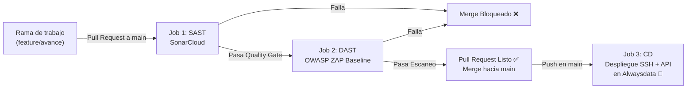

# Guía Paso a Paso: Implementación de Pipeline DevSecOps (SAST + DAST + CD en Alwaysdata)

Este manual detalla paso a paso cómo transformar el proyecto Django **`biblioteca`** desde su estado inicial (con configuraciones locales fijas en código) hasta un flujo **DevSecOps automatizado con GitHub Actions**, que ejecuta análisis de seguridad estático (**SAST con SonarCloud**) y dinámico (**DAST con OWASP ZAP**) en cada *Pull Request*, y despliega automáticamente en el hosting **Alwaysdata** únicamente cuando todas las pruebas de seguridad han sido superadas.

---

## Arquitectura del Flujo DevSecOps

El pipeline se divide en dos momentos clave sobre el repositorio de GitHub:

1. **Al abrir o actualizar un Pull Request hacia `main` (CI + Security Gates):**
   - Se ejecuta **SAST (SonarCloud)** para detectar vulnerabilidades en el código fuente, credenciales expuestas (*hardcoded secrets*) y problemas de calidad.
   - Si SAST aprueba, el runner de GitHub instala el proyecto, levanta Django en un servidor local temporal (puerto `8000`) y ejecuta **DAST (OWASP ZAP Baseline Scan)** para auditar cabeceras HTTP, cookies y respuestas del servidor en ejecución.
   - **El despliegue NO se ejecuta en esta etapa.** Si cualquiera de los dos análisis falla, GitHub bloquea el botón de *Merge*.
2. **Al aprobar y hacer Merge del Pull Request en `main` (CD - Despliegue Continuo):**
   - Una vez que el código ingresa a `main`, se vuelve a validar y se activa el tercer trabajo (**`CD - Despliegue en Alwaysdata`**), el cual se conecta por SSH a Alwaysdata, descarga los últimos cambios desde GitHub, instala dependencias, aplica migraciones, recolecta archivos estáticos y reinicia el servidor WSGI mediante la API de Alwaysdata.



---

## Paso 1: Crear Cuenta, Base de Datos MySQL y Acceso SSH en Alwaysdata

Antes de tocar el código, prepararemos el servidor de hosting donde vivirá nuestra aplicación y su base de datos de producción.

### 1.1. Crear cuenta en Alwaysdata
1. Ingresa a [https://www.alwaysdata.com/](https://www.alwaysdata.com/) y crea una cuenta gratuita (*100 MB free cloud hosting*).
2. Durante el registro elegirás un **nombre de cuenta** (por ejemplo, `mibiblioteca`).
   - **Importante:** Anota ese nombre de cuenta. En toda esta guía lo llamaremos **`<tu-cuenta>`**.
   - Tu sitio web público será: `https://<tu-cuenta>.alwaysdata.net`
   - Tu servidor SSH será: `ssh-<tu-cuenta>.alwaysdata.net`
   - Tu servidor MySQL será: `mysql-<tu-cuenta>.alwaysdata.net`

### 1.2. Crear la Base de Datos MySQL en Alwaysdata
1. En el panel de administración de Alwaysdata, ve al menú lateral izquierdo: **Databases > MySQL**.
2. En la parte superior verás la dirección del servidor (**Host**): `mysql-<tu-cuenta>.alwaysdata.net`. Anótala.
3. Haz clic en **Add a database**:
   - **Name:** `<tu-cuenta>_biblioteca` *(Alwaysdata ya incluye el prefijo `<tu-cuenta>_`, así que escribe `biblioteca` en el campo)*.
   - Haz clic en **Submit**.
4. Ahora crea o verifica tu usuario de base de datos en **Databases > MySQL > Users** (pestaña superior o menú lateral):
   - Haz clic en **Add a MySQL user** (o edita el usuario existente):
   - **Name:** `<tu-cuenta>_dbuser`
   - **Password:** Crea una contraseña segura para la base de datos y **anótala**.
   - **Permissions:** Asegúrate de que tenga **`ALL PRIVILEGES`** sobre la base de datos `<tu-cuenta>_biblioteca`.
   - Haz clic en **Submit**.

### 1.3. Habilitar el Acceso SSH en Alwaysdata
GitHub Actions necesitará conectarse por SSH a Alwaysdata para actualizar el código automáticamente.
1. En el menú lateral izquierdo de Alwaysdata, ve a **Remote access > SSH**.
2. Verás tu usuario principal (que se llama igual que `<tu-cuenta>`). Haz clic en el ícono de **editar (lápiz)** a la derecha:
   - Asigna una **contraseña SSH** segura y **anótala**.
   - Asegúrate de que la opción **Enable password login** esté activada.
   - Haz clic en **Submit**.

---

## Paso 2: Preparar el Proyecto Local (`biblioteca`) y el Archivo `.env`

En su estado original, el proyecto Django tiene la clave secreta (`SECRET_KEY`), el modo de depuración (`DEBUG = True`) y las credenciales de base de datos escritas directamente dentro de `biblioteca/settings.py`.
> **¿Por qué debemos cambiar esto?**
> Dejar contraseñas o claves secretas escritas en el código fuente se conoce como *Hardcoded Credentials* (CWE-798). Si subes eso a GitHub, cualquier persona puede ver tus contraseñas y **SonarCloud reprobará tu análisis de seguridad**. La solución estándar es mover todos los datos sensibles a un archivo **`.env`** que nunca se sube a GitHub.

### 2.1. Instalar librerías necesarias y crear `requirements.txt`
Abre una terminal en la carpeta raíz de tu proyecto `biblioteca` (donde se encuentra el archivo `manage.py`), activa tu entorno virtual local e instala `python-dotenv` (para leer el archivo `.env`) y `PyMySQL` (para conectarse a MySQL tanto en Windows/Mac como en Linux sin errores de compilación):

```bash
pip install python-dotenv PyMySQL
```

Ahora, en la **raíz del proyecto** (junto a `manage.py`), crea el archivo **`requirements.txt`** con el siguiente contenido:

```txt
Django>=5.0,<5.2
python-dotenv>=1.0.1
PyMySQL>=1.1.0
```

> **¿Por qué usamos `requirements.txt`?**
> Tanto el servidor temporal de GitHub Actions (donde corre OWASP ZAP) como el servidor de producción en Alwaysdata leerán este archivo con `pip install -r requirements.txt` para saber exactamente qué paquetes de Python necesita el proyecto.

### 2.2. Habilitar `PyMySQL` en `biblioteca/__init__.py`
Para que Django utilice `PyMySQL` como conector de MySQL sin requerir librerías del sistema operativo, abre el archivo **`biblioteca/__init__.py`** (que originalmente está vacío) y agrega estas dos líneas:

```python
import pymysql

pymysql.install_as_MySQLdb()
```

### 2.3. Crear el archivo `.env` en la raíz del proyecto
En la **raíz del proyecto** (en la misma carpeta donde está `manage.py`), crea un archivo llamado exactamente **`.env`** utilizando los datos de tu cuenta y base de datos de **Alwaysdata** que creaste en el Paso 1:

```env
# --- SEGURIDAD Y ENTORNO ---
SECRET_KEY=clave-secreta-desarrollo-seguro-cambiar-123456789
DEBUG=True
ALLOWED_HOSTS=<tu-cuenta>.alwaysdata.net,localhost,127.0.0.1

# --- BASE DE DATOS MYSQL DE ALWAYSDATA (Creada en el Paso 1.2) ---
DB_ENGINE=django.db.backends.mysql
DB_NAME=<tu-cuenta>_biblioteca
DB_USER=<tu-cuenta>_dbuser
DB_PASSWORD=LA_CONTRASENA_MYSQL_QUE_CREASTE_EN_EL_PASO_1_2
DB_HOST=mysql-<tu-cuenta>.alwaysdata.net
DB_PORT=3306
```

> **💡 Nota para desarrollo local:**
> - Si desde tu computador quieres conectarte directamente a la base de datos MySQL de Alwaysdata, recuerda marcar la casilla **"Allow remote connections"** (Permitir conexiones remotas) en **Databases > MySQL > Users** dentro del panel de Alwaysdata.
> - Si prefieres probar en tu PC con una base de datos local (XAMPP / WAMP / MySQL Workbench), en el `.env` de tu PC puedes poner `DB_HOST=127.0.0.1`, `DB_USER=root`, `DB_PASSWORD=` y `DB_NAME=biblioteca`, y usar los datos de Alwaysdata cuando crees el `.env` en el servidor en el **Paso 6.3**.

**Explicación de cada variable del `.env`:**
- `SECRET_KEY`: Llave criptográfica que usa Django para firmar sesiones y tokens CSRF.
- `DEBUG`: En tu PC es `True` para ver errores detallados; en GitHub Actions y en Alwaysdata será `False` para no revelar información interna ante ataques.
- `ALLOWED_HOSTS`: Lista de dominios autorizados separados por comas. Cuando `DEBUG=False`, Django bloquea cualquier petición cuyo dominio no esté en esta lista.
- `DB_*`: Credenciales de conexión a la base de datos MySQL.

### 2.4. Crear el archivo `.gitignore` en la raíz del proyecto
Para evitar que tu archivo `.env` (con contraseñas), tu entorno virtual o archivos temporales se suban a GitHub, crea un archivo llamado **`.gitignore`** en la raíz del proyecto (junto a `manage.py`):

```gitignore
# Variables de entorno y secretos (NUNCA subir a GitHub)
.env

# Entornos virtuales de Python
venv/
.venv/
env/

# Archivos compilados y caché de Python
__pycache__/
*.py[cod]
*$py.class

# Base de datos SQLite temporal y archivos estáticos compilados
db.sqlite3
staticfiles/

# Archivos temporales de SonarQube local e IDEs
.scannerwork/
.vscode/
.idea/
.DS_Store
```

### 2.5. Actualizar `biblioteca/settings.py` para usar `.env` y soportar CI/CD
Abre el archivo **`biblioteca/settings.py`** y modifica las secciones de importación, seguridad (`SECRET_KEY`, `DEBUG`, `ALLOWED_HOSTS`), base de datos (`DATABASES`) y archivos estáticos (`STATIC_ROOT`) para que queden de la siguiente manera:

```python
import os
from pathlib import Path
from dotenv import load_dotenv

# Build paths inside the project like this: BASE_DIR / 'subdir'.
BASE_DIR = Path(__file__).resolve().parent.parent

# Carga las variables definidas en el archivo .env (si existe)
load_dotenv(BASE_DIR / '.env')

# 1. SEGURIDAD: Leída desde variables de entorno (.env, GitHub Secrets o Alwaysdata)
SECRET_KEY = os.environ.get('SECRET_KEY', 'django-insecure-fallback-solo-desarrollo')

# Convierte el texto "True" en booleano True; cualquier otro valor será False
DEBUG = os.environ.get('DEBUG', 'False') == 'True'

# Lee los hosts separados por coma desde ALLOWED_HOSTS e incluye siempre localhost y 127.0.0.1
env_hosts = os.environ.get('ALLOWED_HOSTS', 'localhost,127.0.0.1')
ALLOWED_HOSTS = [host.strip() for host in env_hosts.split(',') if host.strip()]
for local_host in ['localhost', '127.0.0.1']:
    if local_host not in ALLOWED_HOSTS:
        ALLOWED_HOSTS.append(local_host)
```

Más abajo en el mismo archivo **`biblioteca/settings.py`**, reemplaza la sección **`DATABASES`** por esta configuración:

```python
# 2. BASE DE DATOS: Usa MySQL en local y en Alwaysdata, pero cambia a SQLite en GitHub Actions
if os.environ.get('CI_TESTING') == 'True':
    # Durante el escaneo DAST de OWASP ZAP en GitHub Actions, usa SQLite temporal
    DATABASES = {
        'default': {
            'ENGINE': 'django.db.backends.sqlite3',
            'NAME': BASE_DIR / 'db.sqlite3',
        }
    }
else:
    # En desarrollo local y en Alwaysdata (Producción), usa las variables del archivo .env
    DATABASES = {
        'default': {
            'ENGINE': os.environ.get('DB_ENGINE', 'django.db.backends.mysql'),
            'NAME': os.environ.get('DB_NAME', 'biblioteca'),
            'USER': os.environ.get('DB_USER', 'root'),
            'PASSWORD': os.environ.get('DB_PASSWORD', ''),
            'HOST': os.environ.get('DB_HOST', '127.0.0.1'),
            'PORT': os.environ.get('DB_PORT', '3306'),
        }
    }
```

Finalmente, al final de **`biblioteca/settings.py`**, asegúrate de que la configuración de archivos estáticos incluya **`STATIC_ROOT`**:

```python
# 3. ARCHIVOS ESTÁTICOS (CSS, JS, Imágenes)
STATIC_URL = 'static/'
STATIC_ROOT = BASE_DIR / 'staticfiles'
```

**¿Qué logramos con estos cambios en `settings.py`?**
1. **Cero secretos en el código:** SonarCloud ya no detectará contraseñas expuestas en `settings.py`.
2. **Compatibilidad con OWASP ZAP (`ALLOWED_HOSTS` y `CI_TESTING`):** Cuando GitHub Actions ejecute el proyecto con `DEBUG="False"` y `CI_TESTING="True"`, Django aceptará las peticiones a `http://localhost:8000` y creará una base de datos SQLite limpia en segundos para que OWASP ZAP pueda auditar todas las vistas sin depender de un servidor MySQL externo.
3. **Soporte de producción (`STATIC_ROOT`):** Permite que el comando `python manage.py collectstatic` reúna los estilos CSS e imágenes del proyecto en la carpeta `staticfiles/` para que Alwaysdata los sirva correctamente.

---

## Paso 3: Crear los Archivos de Configuración del Pipeline DevSecOps

### 3.1. Crear `sonar-project.properties` en la raíz del proyecto
En la raíz del proyecto (junto a `manage.py`), crea el archivo **`sonar-project.properties`**:

```properties
# Identificadores de tu proyecto en SonarCloud (los completaremos en el Paso 5)
sonar.projectKey=REEMPLAZAR_POR_TU_PROJECT_KEY
sonar.organization=REEMPLAZAR_POR_TU_ORGANIZATION

# Carpetas del proyecto que contienen nuestro código fuente a evaluar
sonar.sources=biblioteca,gestion
sonar.sourceEncoding=UTF-8

# Exclusiones: carpetas autogeneradas o de terceros que no deben evaluarse
sonar.exclusions=**/migrations/**,**/venv/**,**/.venv/**,**/env/**,**/staticfiles/**,**/tests.py,manage.py
```

### 3.2. Crear el flujo de GitHub Actions `.github/workflows/devsecops.yml`
GitHub Actions exige que los flujos estén guardados exactamente dentro de la carpeta **`.github/workflows/`** en la raíz del repositorio.

1. En la raíz del proyecto (junto a `manage.py`), crea la carpeta `.github` y dentro de ella la carpeta `workflows`.
2. Dentro de `.github/workflows/`, crea el archivo **`devsecops.yml`** con el siguiente contenido:

```yaml
name: Pipeline DevSecOps (SAST + DAST + CD Alwaysdata)

on:
  pull_request:
    branches: [ main ]
  push:
    branches: [ main ]

jobs:
  # =========================================================================
  # JOB 1: ANÁLISIS ESTÁTICO DE SEGURIDAD (SAST) CON SONARCLOUD
  # =========================================================================
  sast-sonarqube:
    name: SAST - Análisis Estático (SonarCloud)
    runs-on: ubuntu-latest
    steps:
      - name: Descargar código del repositorio
        uses: actions/checkout@v4
        with:
          fetch-depth: 0 # Permite a SonarCloud analizar todo el historial de cambios

      - name: Ejecutar escaneo en SonarCloud y verificar Quality Gate
        uses: SonarSource/sonarqube-scan-action@v4
        env:
          SONAR_TOKEN: ${{ secrets.SONAR_TOKEN }}
          GITHUB_TOKEN: ${{ secrets.GITHUB_TOKEN }}
        with:
          args: >
            -Dsonar.qualitygate.wait=true

  # =========================================================================
  # JOB 2: ANÁLISIS DINÁMICO DE SEGURIDAD (DAST) CON OWASP ZAP
  # =========================================================================
  dast-owasp-zap:
    name: DAST - Análisis Dinámico (OWASP ZAP)
    runs-on: ubuntu-latest
    needs: sast-sonarqube # Solo se ejecuta si el análisis estático (SAST) pasó en verde
    steps:
      - name: Descargar código del repositorio
        uses: actions/checkout@v4

      - name: Configurar entorno Python 3.12
        uses: actions/setup-python@v5
        with:
          python-version: '3.12'

      - name: Instalar dependencias y levantar servidor Django en segundo plano
        env:
          SECRET_KEY: ${{ secrets.APP_SECRET_KEY }}
          DEBUG: "False"
          CI_TESTING: "True"
          ALLOWED_HOSTS: "localhost,127.0.0.1"
        run: |
          pip install -r requirements.txt
          python manage.py migrate --noinput
          python manage.py runserver 0.0.0.0:8000 &
          # Esperar hasta 15 segundos verificando que el servidor responda
          for i in {1..15}; do
            if curl -s -o /dev/null http://localhost:8000; then
              echo "Servidor Django escuchando en http://localhost:8000"
              break
            fi
            sleep 1
          done

      - name: Ejecutar OWASP ZAP Baseline Scan
        uses: zaproxy/action-baseline@v0.12.0
        with:
          target: 'http://localhost:8000'
          cmd_options: '-a'
          allow_issue_writing: false # Evita error 403 al no intentar abrir Issues en GitHub

      - name: Subir reporte HTML de OWASP ZAP como evidencia descargable
        if: always()
        uses: actions/upload-artifact@v4
        with:
          name: zap-security-report
          path: report_html.html

  # =========================================================================
  # JOB 3: DESPLIEGUE CONTINUO (CD) EN ALWAYSDATA (SOLO AL HACER MERGE EN MAIN)
  # =========================================================================
  deploy-alwaysdata:
    name: CD - Despliegue en Alwaysdata
    runs-on: ubuntu-latest
    needs: [ sast-sonarqube, dast-owasp-zap ]
    # Solo se ejecuta cuando el código se fusiona (push) en la rama main, NUNCA durante el Pull Request
    if: github.event_name == 'push' && github.ref == 'refs/heads/main'
    steps:
      - name: Actualizar código, dependencias y migraciones por SSH en Alwaysdata
        uses: appleboy/ssh-action@v1.1.0
        with:
          host: ${{ secrets.ALWAYSDATA_HOST }}
          username: ${{ secrets.ALWAYSDATA_USER }}
          password: ${{ secrets.ALWAYSDATA_SSH_PASSWORD }}
          script: |
            set -e
            cd ~/biblioteca
            git pull origin main
            source ~/env/bin/activate
            pip install -r requirements.txt
            python manage.py migrate --noinput
            python manage.py collectstatic --noinput

      - name: Reiniciar sitio Python WSGI mediante la API de Alwaysdata
        run: |
          curl -f -s -X POST \
            --basic --user "${{ secrets.ALWAYSDATA_API_KEY }} account=${{ secrets.ALWAYSDATA_ACCOUNT }}:" \
            "https://api.alwaysdata.com/v1/site/${{ secrets.ALWAYSDATA_SITE_ID }}/restart/"
```

**Explicación de los puntos críticos del archivo `devsecops.yml`:**
- **`-Dsonar.qualitygate.wait=true`**: Hace que GitHub Actions espere el veredicto de SonarCloud. Si el *Quality Gate* queda en rojo, el job falla y bloquea el pipeline.
- **`needs: sast-sonarqube`**: Impide que se gaste tiempo levantando OWASP ZAP si el código ni siquiera pasó la revisión estática de SonarCloud.
- **`allow_issue_writing: false`**: Por defecto, la acción de OWASP ZAP intenta crear un *Issue* en el repositorio y falla con error `403 Forbidden`. Con este parámetro desactivamos esa escritura y guardamos el reporte limpio en `zap-security-report`.
- **`if: github.event_name == 'push' && github.ref == 'refs/heads/main'`**: Esta condición garantiza que mientras el cambio esté en revisión dentro de un *Pull Request*, **solo se ejecuten los análisis SAST y DAST**. Recién cuando el *Pull Request* es aprobado y fusionado en `main`, el evento pasa a ser un `push` sobre `refs/heads/main` y se dispara el despliegue hacia Alwaysdata.

---

## Paso 4: Subir el Proyecto a GitHub por Primera Vez

1. Ingresa a [https://github.com/](https://github.com/) y crea un nuevo repositorio llamado **`biblioteca`**.
   - **Importante:** Selecciona visibilidad **Public** (Público), ya que tanto **SonarCloud** como las **Reglas de Protección de Rama (Branch Protection Rules)** de GitHub son gratuitas en repositorios públicos.
   - **No** marques *"Add a README file"* ni *".gitignore"* al crearlo en la web, porque ya los creamos localmente.
2. Abre la terminal en la carpeta raíz de tu proyecto local `biblioteca` y ejecuta uno por uno los siguientes comandos:

```bash
# 1. Inicializar el repositorio Git local (si aún no estaba inicializado)
git init

# 2. Asegurar que la rama principal se llame 'main'
git branch -M main

# 3. Verificar qué archivos se van a subir
git status
```

> ⚠️ **VERIFICACIÓN DE SEGURIDAD ANTES DE CONTINUAR:**
> Revisa la salida de `git status`. El archivo **`.env` NO debe aparecer en la lista** (porque está protegido por `.gitignore`). Si llegara a aparecer, revisa que tu archivo `.gitignore` esté bien escrito en la raíz del proyecto.

```bash
# 4. Agregar todos los archivos del proyecto al área de preparación
git add .

# 5. Crear el primer commit
git commit -m "chore: preparar proyecto biblioteca para pipeline DevSecOps y variables de entorno"

# 6. Vincular tu carpeta local con tu repositorio de GitHub (reemplaza TU_USUARIO_GITHUB)
git remote add origin https://github.com/TU_USUARIO_GITHUB/biblioteca.git

# 7. Subir el proyecto a la rama main en GitHub
git push -u origin main
```

*(Nota: Al subirlo ahora, verás en la pestaña **Actions** de GitHub que el flujo se ejecuta y falla. ¡Es normal! Aún falta vincular SonarCloud y cargar los Secrets en los Pasos 5, 6 y 7).*

---

## Paso 5: Configurar SonarCloud y Actualizar `sonar-project.properties`

1. Ingresa a [https://sonarcloud.io/](https://sonarcloud.io/) y haz clic en **Log in > With GitHub**.
2. Autoriza a SonarCloud para acceder a tu cuenta de GitHub.
3. Arriba a la derecha, haz clic en el botón **`+` > Analyze new project**.
4. Selecciona tu repositorio **`biblioteca`** y haz clic en **Set Up**.
5. Elige el plan gratuito (**Free Plan**) y haz clic en **Create Project**.
6. 🚨 **PASO CRÍTICO (Desactivar Automatic Analysis):**
   - Una vez dentro de tu proyecto en SonarCloud, ve al menú lateral izquierdo: **Administration > Analysis Method**.
   - Verás un interruptor llamado **Automatic Analysis**. **APÁGALO (OFF)**.
   - *¿Por qué?* Si dejas *Automatic Analysis* encendido, SonarCloud rechazará el análisis enviado desde GitHub Actions indicando que ambos métodos no pueden estar activos al mismo tiempo.
7. En esa misma pantalla (**Administration > Analysis Method**), haz clic en **With GitHub Actions**:
   - SonarCloud te mostrará un **`SONAR_TOKEN`**. **Cópialo y guárdalo en un bloc de notas** (lo usaremos en el Paso 7).
   - Debajo verás los valores exactos de **`sonar.projectKey`** y **`sonar.organization`** de tu cuenta.
8. Abre tu archivo local **`sonar-project.properties`** (creado en el Paso 3.1) y reemplaza las dos primeras líneas con tus valores reales de SonarCloud. Por ejemplo:

```properties
sonar.projectKey=juanperez_biblioteca
sonar.organization=juanperez

sonar.sources=biblioteca,gestion
sonar.sourceEncoding=UTF-8
sonar.exclusions=**/migrations/**,**/venv/**,**/.venv/**,**/env/**,**/staticfiles/**,**/tests.py,manage.py
```

9. **Sube este cambio a GitHub:**

```bash
git add sonar-project.properties
git commit -m "chore: configurar projectKey y organization reales de SonarCloud"
git push origin main
```

---

## Paso 6: Configurar el Proyecto y el Archivo `.env` dentro de Alwaysdata

Para que GitHub Actions pueda desplegar automáticamente con `git pull`, primero debemos dejar el repositorio clonado, el entorno virtual creado y el archivo `.env` de producción dentro de Alwaysdata.

### 6.1. Conectarse por SSH a Alwaysdata
Abre la terminal en tu computador y conéctate a tu servidor Alwaysdata (reemplaza `<tu-cuenta>` por el nombre de tu cuenta de Alwaysdata):

```bash
ssh <tu-cuenta>@ssh-<tu-cuenta>.alwaysdata.net
```
*(Escribe `yes` si te pregunta por la huella del servidor e ingresa la contraseña SSH que configuraste en el Paso 1.3).*

### 6.2. Clonar tu repositorio de GitHub y crear el entorno virtual en Alwaysdata
Una vez dentro de la terminal SSH de Alwaysdata, ejecuta uno por uno los siguientes comandos:

```bash
# 1. Asegurarse de estar en la carpeta raíz de tu usuario (/home/<tu-cuenta>)
cd ~

# 2. Clonar tu repositorio desde GitHub (reemplaza TU_USUARIO_GITHUB)
git clone https://github.com/TU_USUARIO_GITHUB/biblioteca.git ~/biblioteca

# 3. Crear el entorno virtual de Python en ~/env
python3 -m venv ~/env

# 4. Activar el entorno virtual e instalar las dependencias del proyecto
source ~/env/bin/activate
pip install --upgrade pip
pip install -r ~/biblioteca/requirements.txt
```

### 6.3. Crear el archivo `.env` de Producción dentro de Alwaysdata
Como el archivo `.env` no se sube a GitHub por seguridad, debemos crearlo directamente dentro de la carpeta `~/biblioteca/` en Alwaysdata con las credenciales de la base de datos MySQL que creamos en el Paso 1.2.

En la misma sesión SSH de Alwaysdata, abre el editor `nano`:

```bash
nano ~/biblioteca/.env
```

Pega el siguiente contenido (reemplazando `<tu-cuenta>` y tu contraseña de base de datos real):

```env
# --- SEGURIDAD Y DOMINIO EN PRODUCCIÓN (ALWAYSDATA) ---
SECRET_KEY=pon-aqui-una-clave-secreta-larga-y-unica-para-produccion-987654321
DEBUG=False
ALLOWED_HOSTS=<tu-cuenta>.alwaysdata.net,localhost,127.0.0.1

# --- BASE DE DATOS MYSQL DE ALWAYSDATA (Creada en el Paso 1.2) ---
DB_ENGINE=django.db.backends.mysql
DB_NAME=<tu-cuenta>_biblioteca
DB_USER=<tu-cuenta>_dbuser
DB_PASSWORD=LA_CONTRASENA_MYSQL_QUE_CREASTE_EN_EL_PASO_1_2
DB_HOST=mysql-<tu-cuenta>.alwaysdata.net
DB_PORT=3306
```

Para guardar y salir de `nano`:
1. Presiona **`Ctrl + O`** y luego **`Enter`** (para guardar el archivo).
2. Presiona **`Ctrl + X`** (para salir del editor).

Ahora protege los permisos del archivo `.env` y ejecuta la primera migración y recolección de archivos estáticos para comprobar que todo funciona:

```bash
# Proteger el archivo .env para que solo tu usuario pueda leerlo
chmod 600 ~/biblioteca/.env

# Entrar a la carpeta del proyecto
cd ~/biblioteca

# Ejecutar migraciones en la base de datos MySQL de Alwaysdata
python manage.py migrate

# Reunir los archivos estáticos en ~/biblioteca/staticfiles
python manage.py collectstatic --noinput
```

Si ambos comandos terminan sin errores (`OK`), ya puedes cerrar la sesión SSH escribiendo `exit`.

### 6.4. Configurar el Sitio Web Python WSGI en el Panel de Alwaysdata
1. Vuelve al panel web de Alwaysdata y ve al menú lateral izquierdo: **Web > Sites**.
2. Edita el sitio existente (ícono del lápiz) o haz clic en **Add a site** con los siguientes datos exactos (reemplazando `<tu-cuenta>` por tu nombre de cuenta):
   - **Name:** `Biblioteca`
   - **Addresses:** `<tu-cuenta>.alwaysdata.net`
   - **Type:** Selecciona **`Python WSGI`**
   - **Application path:** `/home/<tu-cuenta>/biblioteca/biblioteca/wsgi.py`
   - **Working directory:** `/home/<tu-cuenta>/biblioteca`
   - **Virtualenv directory:** `/home/<tu-cuenta>/env`
   - **Static paths** (en la sección inferior):
     - **URL prefix:** `/static/`
     - **Directory:** `/home/<tu-cuenta>/biblioteca/staticfiles`
3. Haz clic en **Submit**.
4. **Anota el ID del Sitio (`SITE_ID`):** En la tabla de **Web > Sites**, a la izquierda del nombre de tu sitio verás un número de 6 dígitos (por ejemplo, `123456`). **Anótalo**, ya que es tu `ALWAYSDATA_SITE_ID`.

### 6.5. Generar el API Token en Alwaysdata para el Reinicio Automático
Para que GitHub Actions pueda reiniciar tu sitio web automáticamente cada vez que actualice el código:
1. En el panel de Alwaysdata, haz clic arriba a la derecha sobre tu nombre de usuario y entra a **Permissions > API tokens** (o directamente en [https://admin.alwaysdata.com/token/](https://admin.alwaysdata.com/token/)).
2. Haz clic en **Add an API token**:
   - **Name:** `github-actions`
   - **Allowed IP addresses:** Déjalo **en blanco** (vacío), porque los servidores de GitHub Actions cambian de IP en cada ejecución.
3. Haz clic en **Submit** y **copia el Token generado** (es una cadena alfanumérica larga). Este será tu `ALWAYSDATA_API_KEY`.

---

## Paso 7: Configurar GitHub Secrets y Proteger la Rama `main`

### 7.1. Cargar los Secrets en tu Repositorio de GitHub
1. Entra a tu repositorio `biblioteca` en GitHub.
2. Ve a la pestaña superior **Settings** (Configuración del repositorio).
3. En el menú lateral izquierdo, despliega **Secrets and variables** y haz clic en **Actions**.
4. Haz clic en el botón verde **New repository secret** y crea uno por uno los siguientes **8 secretos**:

| Nombre del Secret (`Name`) | Qué valor debes pegar en `Secret` | Ejemplo de valor |
| :--- | :--- | :--- |
| `SONAR_TOKEN` | El token que copiaste de SonarCloud en el **Paso 5.7**. | `3a8f9b...` |
| `APP_SECRET_KEY` | Cualquier clave aleatoria para levantar Django durante el test de ZAP. | `clave-test-zap-github-actions-12345` |
| `ALWAYSDATA_HOST` | La dirección del servidor SSH de tu cuenta Alwaysdata. | `ssh-mibiblioteca.alwaysdata.net` |
| `ALWAYSDATA_USER` | Tu nombre de usuario SSH de Alwaysdata (**Paso 1.3**). | `mibiblioteca` |
| `ALWAYSDATA_SSH_PASSWORD` | La contraseña SSH de tu usuario de Alwaysdata (**Paso 1.3**). | `MiPasswordSSH2026!` |
| `ALWAYSDATA_ACCOUNT` | El nombre de tu cuenta de Alwaysdata (sin `.alwaysdata.net`). | `mibiblioteca` |
| `ALWAYSDATA_API_KEY` | El API Token que creaste en Alwaysdata en el **Paso 6.5**. | `a1b2c3d4e5f6...` |
| `ALWAYSDATA_SITE_ID` | El ID numérico de 6 dígitos de tu sitio en Alwaysdata (**Paso 6.4**). | `845123` |

### 7.2. Ejecutar el Pipeline por Primera Vez y Verificar que Pase en Verde
1. En tu repositorio de GitHub, ve a la pestaña superior **Actions**.
2. Entra a la última ejecución del workflow (`Pipeline DevSecOps (SAST + DAST + CD Alwaysdata)`) que había fallado antes de cargar los Secrets.
3. Arriba a la derecha, haz clic en **Re-run all jobs**.
4. Observa cómo se ejecutan en orden:
   - ✅ **SAST - Análisis Estático (SonarCloud)**
   - ✅ **DAST - Análisis Dinámico (OWASP ZAP)**
   - ✅ **CD - Despliegue en Alwaysdata**
5. Una vez que los 3 estén en verde, abre en tu navegador `https://<tu-cuenta>.alwaysdata.net` y verifica que tu aplicación **`biblioteca`** esté funcionando en vivo.

### 7.3. Bloquear la Rama `main` para Activar los Security Gates
Ahora que GitHub conoce los nombres de los trabajos de seguridad, configuraremos la regla para que **nadie pueda subir cambios directo a `main`** y todo cambio deba pasar por un *Pull Request* auditado por SonarCloud y OWASP ZAP.

1. En tu repositorio de GitHub, ve a **Settings > Branches** (en el menú lateral izquierdo).
2. En la sección *Branch protection rules*, haz clic en **Add classic branch protection rule** (o **Add branch protection rule**).
3. En **Branch name pattern**, escribe exactamente:
   ```txt
   main
   ```
4. Marca las siguientes casillas de verificación:
   - ☑️ **Require a pull request before merging**
     - *(Consejo: Si estás trabajando de forma individual en tu repositorio, **desmarca** la sub-casilla "Require approvals" para que no te exija la firma de otra cuenta de GitHub, pero mantén marcada la casilla principal "Require a pull request before merging").*
   - ☑️ **Require status checks to pass before merging**
     - ☑️ Marca también **Require branches to be up to date before merging**.
     - En la barra de búsqueda de *Status checks*, escribe `SAST` y haz clic sobre **`SAST - Análisis Estático (SonarCloud)`** para agregarlo.
     - Luego escribe `DAST` y haz clic sobre **`DAST - Análisis Dinámico (OWASP ZAP)`** para agregarlo.
     - *(No agregues el job de CD aquí, ya que el despliegue solo corre después del merge).*
   - ☑️ **Do not allow bypassing the above settings**
     - *(Es fundamental marcar esta opción para que la regla también se aplique a ti como dueño/administrador del repositorio).*
5. Baja hasta el final de la página y haz clic en **Create** (o **Save changes**).

---

## Paso 8: Cómo Trabajar un Nuevo Avance con el Pipeline DevSecOps Activo

A partir de este momento, la rama `main` está protegida. Cada vez que quieras agregar una mejora, corregir una vulnerabilidad o modificar una plantilla HTML en el proyecto **`biblioteca`**, sigue estos pasos:

### 8.1. Crear una rama para tu nuevo avance
En la terminal de tu proyecto local:

```bash
# 1. Asegurarte de estar en main y tener la última versión
git checkout main
git pull origin main

# 2. Crear y cambiarte a una nueva rama para tu avance
git checkout -b feature/nuevo-avance
```

### 8.2. Realizar tus cambios y subir la nueva rama a GitHub
Realiza las modificaciones que necesites en el código o en las plantillas de `gestion/templates/`. Cuando termines, guárdalas y súbelas a tu rama:

```bash
# 1. Revisar los archivos modificados
git status

# 2. Agregar los cambios y crear el commit
git add .
git commit -m "feat: implementar mejora en el módulo de gestión"

# 3. Subir la rama nueva a GitHub
git push -u origin feature/nuevo-avance
```

### 8.3. Abrir el Pull Request y observar los Security Gates
1. Entra a tu repositorio en GitHub. Verás un aviso amarillo con el botón verde **Compare & pull request**. Haz clic en él.
2. Verifica que la flecha indique: `base: main` ← `compare: feature/nuevo-avance`.
3. Escribe un título y descripción breve de tu cambio y haz clic en **Create pull request**.
4. **¿Qué ocurre automáticamente en esa misma pantalla?**
   - Verás aparecer la caja de verificaciones (**Checks**) ejecutando:
     1. 🟡 `SAST - Análisis Estático (SonarCloud)`
     2. 🟡 `DAST - Análisis Dinámico (OWASP ZAP)`
   - Mientras los escaneos están corriendo (o si alguno detecta una vulnerabilidad crítica), **el botón "Merge pull request" estará bloqueado**.

### 8.4. Descargar el Reporte de OWASP ZAP (Evidencia)
1. Cuando el check `DAST - Análisis Dinámico (OWASP ZAP)` termine, haz clic en **Details** al lado del check (o entra a la pestaña **Actions** y selecciona la ejecución de tu Pull Request).
2. En el resumen de la ejecución (**Summary**), baja hasta la sección **Artifacts**.
3. Haz clic sobre **`zap-security-report`** para descargar el archivo `.zip` que contiene el **`report_html.html`** generado por OWASP ZAP como evidencia técnica.

### 8.5. Fusionar el Pull Request (Merge) y Despliegue Automático en Alwaysdata
1. Una vez que tanto **SAST (SonarCloud)** como **DAST (OWASP ZAP)** estén con un ticket verde ✅ en tu Pull Request, el botón **Merge pull request** se habilitará.
2. Haz clic en **Merge pull request** y luego en **Confirm merge**.
3. Ve a la pestaña **Actions**: verás que al fusionarse el código en `main`, se ejecuta el flujo completo y esta vez **sí se activa el tercer trabajo: `CD - Despliegue en Alwaysdata`**.
4. Cuando `CD - Despliegue en Alwaysdata` termine en verde ✅ (tarda alrededor de 20 segundos tras los análisis), recarga `https://<tu-cuenta>.alwaysdata.net` y verás tu nuevo avance publicado automáticamente en internet.

---

## Anexo: Solución de Problemas Frecuentes (Troubleshooting)

| Error en GitHub Actions | Causa | Cómo solucionarlo |
| :--- | :--- | :--- |
| **`You are running CI analysis while Automatic Analysis is enabled`** en el job de SonarCloud | Olvidaste apagar el análisis automático al importar el proyecto en SonarCloud. | Entra a SonarCloud → tu proyecto → **Administration > Analysis Method** y apaga (**OFF**) el interruptor **Automatic Analysis**. Luego haz *Re-run failed jobs* en GitHub. |
| **`Project not found`** o error de permisos en SonarCloud | Los valores de `sonar-project.properties` no coinciden con los de SonarCloud o falta el `SONAR_TOKEN`. | Revisa en SonarCloud (**Administration > Analysis Method > GitHub Actions**) los valores exactos de `sonar.projectKey` y `sonar.organization`, actualízalos en `sonar-project.properties` y verifica el secret `SONAR_TOKEN`. |
| **`DisallowedHost at /` (HTTP 400 Bad Request)** en Alwaysdata o en OWASP ZAP | El dominio no está incluido dentro de `ALLOWED_HOSTS` cuando `DEBUG=False`. | Verifica que en `~/biblioteca/.env` dentro de Alwaysdata tengas `ALLOWED_HOSTS=<tu-cuenta>.alwaysdata.net,localhost,127.0.0.1` y reinicia el sitio en **Web > Sites**. |
| **`ssh: handshake failed: ssh: unable to authenticate`** en el job `deploy-alwaysdata` | Usuario, host o contraseña SSH incorrectos en GitHub Secrets, o el login por contraseña está desactivado en Alwaysdata. | Revisa los secrets `ALWAYSDATA_HOST` (`ssh-<tu-cuenta>.alwaysdata.net`), `ALWAYSDATA_USER` y `ALWAYSDATA_SSH_PASSWORD`, y verifica en Alwaysdata (**Remote access > SSH**) que esté activo *Enable password login*. |
| **`curl: (22) The requested URL returned error: 401`** al reiniciar el sitio en Alwaysdata | El `ALWAYSDATA_API_KEY`, `ALWAYSDATA_ACCOUNT` o `ALWAYSDATA_SITE_ID` tienen un error de tipeo. | Verifica en Alwaysdata (**Permissions > API tokens**) que el token no tenga restricción de IP y que `ALWAYSDATA_SITE_ID` sea el número de 6 dígitos que aparece en **Web > Sites**. |
